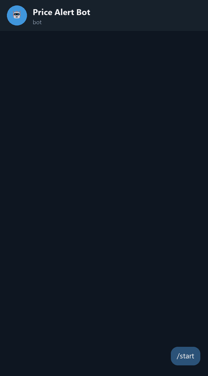

# 🔔 Price Alert Bot: crypto price alerts in Telegram

A Telegram bot that watches cryptocurrency prices and messages you the moment a price reaches your level. You don't have to stare at charts.

<p align="center"></p>

## What it does

- **Any coin on CoinGecko**, about 15,000 of them. Type a ticker or a name, like `BTC`, `ETH` or `solana`. If several coins share a ticker, the bot asks you to pick one.
- **3 alert types:**
  - 📈 **Above:** "tell me when BTC reaches $70,000". Fires once.
  - 📉 **Below:** "tell me when ETH drops to $1,500". Fires once.
  - ⚡ **Move ±N %:** "tell me every time TON moves 5%". This alert repeats, and each time it counts from the new price.
- **My alerts:** see all your alerts and delete any with one tap.
- **Prices:** a quick view of the coins you watch, with their 24-hour change.
- **Smart checks:** if the price is already past your level, the bot warns you instead of firing at once.
- **Russian and English interface:** picked automatically from the user's Telegram language, and switchable with one button.

## Demo flow

```
➕ New alert → "btc" → Bitcoin (BTC) — Now: $61,254 (+1.0% in 24h)
→ 📈 Price above… → 65000
✅ Done! I'll message you when BTC rises to $65,000.
...
🚀 BTC rose to $65,012 (your level $65,000)
```

## How it works

- A background task asks CoinGecko for the prices of **all coins watched by all users in one batched request** each minute. This stays well inside the free API limits, even with many users.
- Alerts are stored in SQLite, so they survive restarts.
- If a user blocks the bot, their alerts are switched off automatically.
- No API keys are needed. You only need a bot token from @BotFather.

## Run it

```bash
python -m venv .venv
.venv\Scripts\activate          # Linux/macOS: source .venv/bin/activate
pip install -r requirements.txt
copy .env.example .env          # Linux/macOS: cp .env.example .env
# put your BotFather token into .env
python bot.py
```

Settings in `.env`:

| Setting | Meaning |
|---|---|
| `CHECK_SECONDS` | How often prices are checked, in seconds |
| `CURRENCY` | The quote currency, such as `usd`, `eur` or `rub` |
| `MAX_ALERTS_PER_USER` | The maximum number of alerts per user |

## Tech

Python 3.10+, [aiogram 3](https://docs.aiogram.dev) with a finite-state machine for the dialog, aiohttp, SQLite, and the CoinGecko public API. The whole bot is one file of about 430 lines.

## Custom versions

The same engine can watch other things. Examples:
- stock prices or exchange rates;
- marketplace listings (eBay, Avito, NFT markets);
- product prices in online shops;
- prices from any API.

You can also add paid subscriptions through Telegram Stars, alert channels, or price charts.

---

### 🇷🇺 Кратко по-русски

Это бот-оповещалка о ценах криптовалют. Он знает любую монету с CoinGecko и умеет три вида оповещений: цена выше уровня, ниже уровня или изменение на ±N %. Бот проверяет цены раз в минуту одним общим запросом для всех пользователей. Интерфейс на русском и английском.
